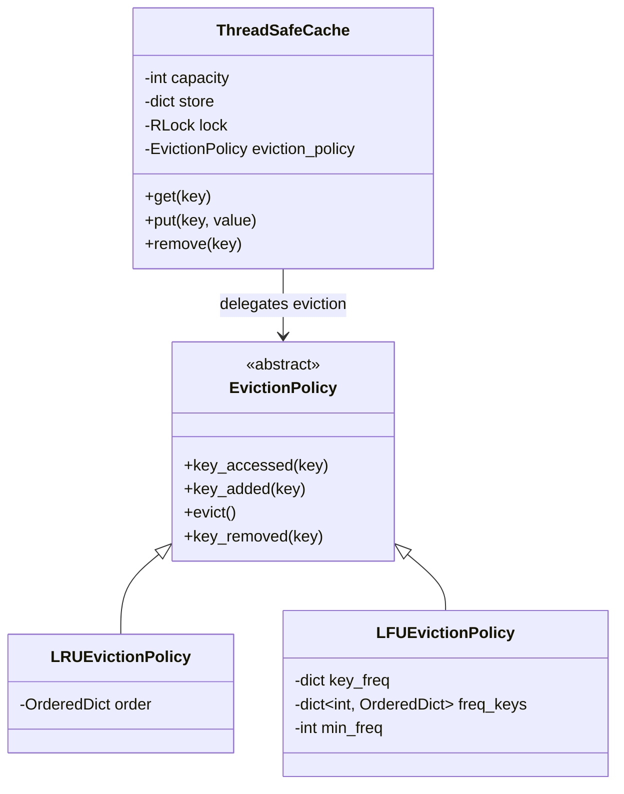
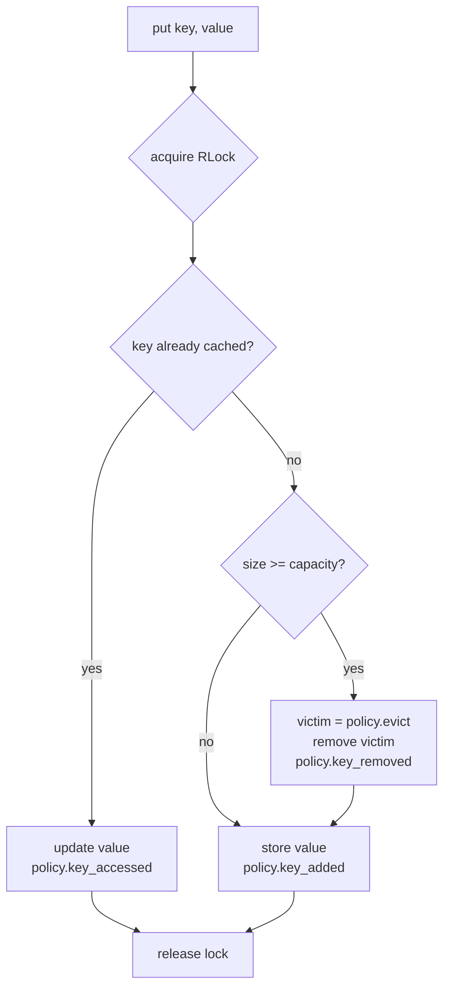

# Concurrent Cache

> A thread-safe, in-memory key-value cache in pure Python with pluggable eviction policies (LRU and LFU) and a multi-threaded benchmark to compare them.

<p align="left">
  
  
  
  
</p>

---

## Features

- **Thread-safe core** – `ThreadSafeCache` guards every `get`, `put` and `remove` with a single `threading.RLock`, so multiple threads can share one cache safely.
- **Pluggable eviction (Strategy pattern)** – the cache takes any object implementing the abstract `EvictionPolicy` interface (`key_accessed`, `key_added`, `evict`, `key_removed`).
- **LRU policy** – backed by `collections.OrderedDict`; accessed keys move to the end, the oldest key is evicted.
- **LFU policy** – O(1) access and eviction using a key → frequency map plus a frequency → keys map (`OrderedDict` buckets, so ties go to the least recently used key).
- **Capacity-bounded** – when the cache is full, the policy chooses which key to drop before the new key is inserted.
- **Benchmark harness** – runs N threads × M `put`/`get` operations against each policy and records the timings.
- **Zero runtime dependencies** – only the Python standard library (`pytest` for tests).

## Tech Stack

| Area | Tools |
|------|-------|
| Language | Python 3 |
| Concurrency | `threading` (`RLock`, `Thread`) |
| Data structures | `dict`, `collections.OrderedDict`, `collections.defaultdict` |
| Design | `abc.ABC` abstract base class (Strategy pattern) |
| Testing / benchmarking | `pytest`, `time.perf_counter` |

## Architecture



`put` flow:



## Project Structure

```
concurrent_cache/
├── cache/
│   ├── __init__.py          # exports ThreadSafeCache, EvictionPolicy, LRU/LFU policies
│   ├── cache.py             # ThreadSafeCache
│   ├── eviction_policy.py   # EvictionPolicy abstract base class
│   ├── lru_policy.py        # LRUEvictionPolicy (OrderedDict, O(1))
│   └── lfu_policy.py        # LFUEvictionPolicy (frequency buckets, O(1))
├── benchmarks/
│   ├── __init__.py
│   └── benchmark.py         # LRU vs LFU multi-threaded benchmark
├── tests/
│   └── test_cache.py        # pytest: eviction order, capacity, remove, LFU invariants, thread safety
├── docs/
│   ├── design_summary.txt   # Design notes
│   └── performance_report.txt
├── benchmark_output.txt     # Last recorded benchmark run
├── main.py                  # Minimal usage example
├── run_benchmarks.bat       # Windows helper for the benchmark
└── requirements.txt
```

## Getting Started

```bash
git clone https://github.com/Gonugunta-Venkata-Jayanth/concurrent_cache.git
cd concurrent_cache
pip install -r requirements.txt   # only pytest; the cache itself needs no packages
```

Run the example:

```bash
python main.py
# 1
# None
```

Run the tests:

```bash
python -m pytest
```

Run the benchmark (writes `benchmark_output.txt`):

```bash
# macOS / Linux
PYTHONPATH=. python -m benchmarks.benchmark

# Windows
run_benchmarks.bat
```

## Usage

```python
from cache import ThreadSafeCache, LRUEvictionPolicy, LFUEvictionPolicy

cache = ThreadSafeCache(capacity=2, eviction_policy=LRUEvictionPolicy())
cache.put("a", 1)
cache.put("b", 2)
cache.get("a")        # -> 1  ("a" becomes most recently used)
cache.put("c", 3)     # evicts "b"
cache.get("b")        # -> None

lfu_cache = ThreadSafeCache(capacity=100, eviction_policy=LFUEvictionPolicy())
```

Writing your own policy only requires subclassing `EvictionPolicy` and implementing its four methods. Policies don't lock on their own: `ThreadSafeCache` calls them only while holding its lock.

## Results

The benchmark (`benchmarks/benchmark.py`) uses a cache of capacity 500, 5 threads and 10,000 `put` + `get` operations per thread over 1,000 distinct keys. The run committed in [`benchmark_output.txt`](benchmark_output.txt) (Python 3.12, 2-core Linux sandbox) recorded:

| Policy | Time |
|--------|------|
| LRUEvictionPolicy | 0.1157 s |
| LFUEvictionPolicy | 0.1451 s |

Over three consecutive runs on that machine LRU took 0.073–0.116 s and LFU 0.107–0.145 s. The previous LFU, which scanned every key with `min()` on each eviction (O(n)), took 0.48–0.54 s on the same machine and workload, so the frequency-bucket LFU is roughly 4× faster here and now close to LRU. Timings are noisy and depend on the machine and Python version. See [`docs/performance_report.txt`](docs/performance_report.txt) for the qualitative analysis.

## Future Work

- Finer-grained locking / lock striping to reduce contention
- TTL expiry, hit/miss statistics, and more policies (FIFO, ARC)
- Package for `pip install` and add CI

## Author

**GV Jayanth** – [GitHub @Gonugunta-Venkata-Jayanth](https://github.com/Gonugunta-Venkata-Jayanth)
